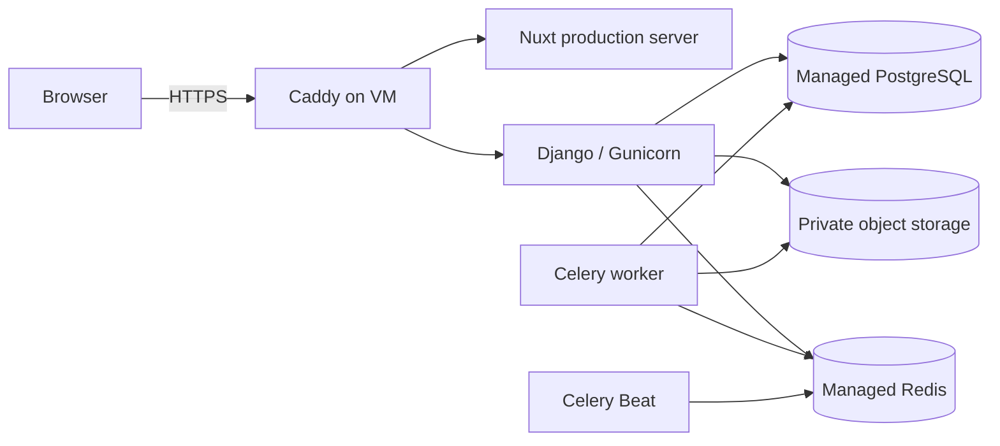

# Cloud Production Deployment

This guide deploys Flockwise to a single cloud VM while using managed PostgreSQL, managed Redis, and private S3-compatible object storage. Application containers remain provider-neutral and can move between cloud vendors.

## Production Topology



Only ports 80 and 443 are public. Django, Nuxt, and Celery use the private Compose network. The database, Redis, and object bucket must reject public access and allow only the workload identity or VM network.

## Infrastructure Checklist

- Linux VM with Docker Engine and Compose v2
- DNS `A`/`AAAA` record pointing the application hostname to the VM
- Firewall allowing inbound 80/443 and restricting SSH to trusted addresses
- Managed PostgreSQL 17 with automated backups and point-in-time recovery
- Managed Redis with TLS and authentication
- Private, encrypted, versioned S3-compatible bucket
- Container registry for immutable API and web images
- SMTP or transactional email provider if password recovery is enabled

Use a minimum of 4 GB RAM for the default container limits and operating-system headroom. Monitor actual usage before changing worker concurrency or Gunicorn workers.

## Build and Publish Images

The normal release path is a semantic-version tag. Pushing a tag such as `v0.1.0` runs the full CI workflow and publishes multi-architecture `flockwise-api` and `flockwise-web` images to GHCR with SBOM and provenance metadata. See [Continuous Integration and Releases](ci-cd.md).

For a manual build, choose an immutable release tag such as a Git commit SHA:

```bash
export REGISTRY=ghcr.io/your-account
export RELEASE=$(git rev-parse --short=12 HEAD)

docker buildx build \
  --target production \
  --platform linux/amd64,linux/arm64 \
  --tag "$REGISTRY/flockwise-api:$RELEASE" \
  --push \
  backend

docker buildx build \
  --target production \
  --platform linux/amd64,linux/arm64 \
  --tag "$REGISTRY/flockwise-web:$RELEASE" \
  --push \
  frontend
```

Use registry digests instead of mutable tags when practical. The cloud host does not need source code to build images; it needs `docker-compose.cloud.yml`, `Caddyfile`, and its environment configuration.

## Configure the Cloud Host

```bash
cp .env.cloud.example .env.cloud
chmod 600 .env.cloud
```

Set the public hostname, image references, managed-service endpoints, and secrets. Generate the Django secret with `openssl rand -base64 48`. Prefer a VM/task identity for object storage; use static `AWS_*` credentials only when the provider cannot supply a workload identity.

For AWS S3, `AWS_S3_ENDPOINT_URL` remains empty. For another compatible provider, set its HTTPS endpoint and region. The bucket must remain private; Flockwise reads files through authenticated API endpoints rather than public bucket URLs.

## First Deployment

```bash
docker compose --env-file .env.cloud -f docker-compose.cloud.yml config --quiet
docker compose --env-file .env.cloud -f docker-compose.cloud.yml pull
docker compose --env-file .env.cloud -f docker-compose.cloud.yml up -d
docker compose --env-file .env.cloud -f docker-compose.cloud.yml ps
```

The API container applies migrations before Gunicorn starts. Celery services wait for the API health check, preventing concurrent migration attempts. Caddy requests and renews the public TLS certificate automatically after DNS and firewall configuration are correct.

Create the administrative account:

```bash
docker compose --env-file .env.cloud -f docker-compose.cloud.yml exec api \
  python manage.py createsuperuser
```

Verify `/livez/`, `/readyz/`, login, file upload/download, password recovery, a background reminder, and one database write. Confirm the PWA manifest and service worker are served over HTTPS.

## Secrets and Access

- Never commit `.env.cloud`; restrict it to the deployment user.
- Prefer a cloud secret manager that renders environment variables at service startup.
- Give the workload identity access only to the application bucket prefix.
- Restrict PostgreSQL and Redis to private networking or explicit VM security groups.
- Do not expose ports 3000, 8000, 5432, or 6379.
- Rotate database, Redis, email, and static object-storage credentials after suspected exposure.

## Backups and Recovery

Enable managed PostgreSQL automated backups and point-in-time recovery. Enable bucket versioning, lifecycle policies, and provider replication if the data warrants it. These are the authoritative cloud backups; the local backup scripts target the self-contained Compose deployment.

Record and test:

1. restoring PostgreSQL to a new managed instance;
2. recovering deleted or overwritten attachment objects;
3. updating `.env.cloud` to the restored endpoints;
4. starting the matching application image revision;
5. validating record counts and attachment downloads.

A backup is not reliable until a restore has been tested.

## Upgrade and Rollback

Before upgrading, confirm a recent database restore point and bucket versioning. Publish new immutable images, update `API_IMAGE` and `WEB_IMAGE`, validate configuration, then deploy:

```bash
docker compose --env-file .env.cloud -f docker-compose.cloud.yml pull
docker compose --env-file .env.cloud -f docker-compose.cloud.yml up -d
docker compose --env-file .env.cloud -f docker-compose.cloud.yml ps
docker compose --env-file .env.cloud -f docker-compose.cloud.yml logs --tail=200 api worker web
```

For a code-only rollback, restore the previous image references. If a migration is not backward compatible or newer writes must be discarded, restore the matching pre-upgrade database recovery point and object versions before starting the previous images.

## Monitoring

At minimum, collect container logs and alert on:

- external HTTPS and `/livez/` failures;
- sustained `/readyz/` failures identifying PostgreSQL or Redis unavailability;
- repeated container restarts or unhealthy status;
- PostgreSQL storage, connection, and backup failures;
- Redis connectivity and memory pressure;
- Celery task failures or a missing Beat schedule;
- object-storage permission and capacity errors;
- TLS certificate renewal failures.

The Compose logging driver rotates local logs. Forward logs to the provider's logging service if the VM is not routinely inspected.
